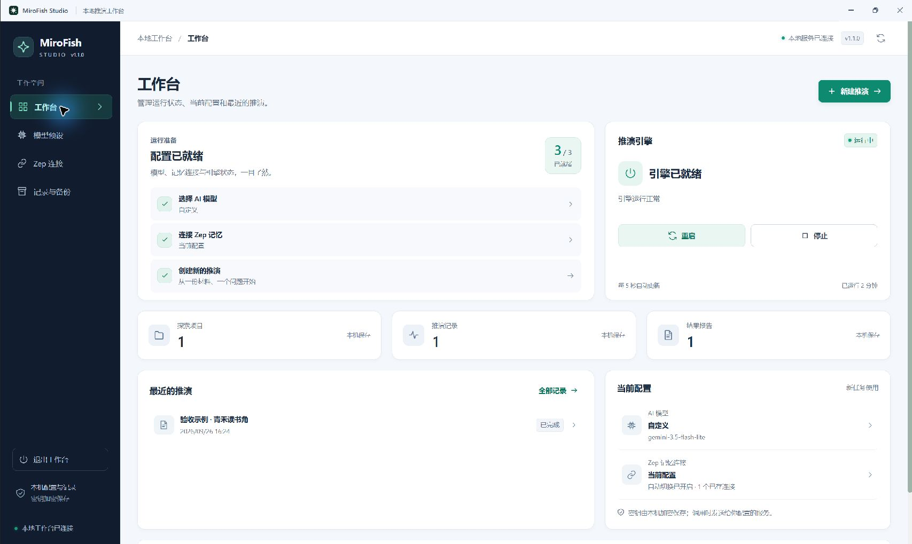

# MiroFish Studio for Windows

**English** · [中文](./README-ZH.md)

A desktop workbench for MiroFish on Windows. It manages model presets, Zep connections, the simulation engine and record backups from a standalone application window with a tray icon, so you never need a browser console.

This repository is an **unofficial Windows adaptation** of [MiroFish](https://github.com/666ghj/MiroFish). The desktop application is the supported way to use it, and installers are distributed through this repository's GitHub Releases.

[Download](https://github.com/lu0973-cb02d/mirofish-studio-windows/releases) · [User guide (中文)](./STUDIO_README.md) · [Release notes (中文)](./RELEASE_NOTES.md) · [Changes](./CHANGELOG.md) · [Source and licence](./NOTICE.md)

The application interface and the user guide are in Chinese.

## Choosing an installer

Windows x64 only. **Full Setup** is recommended for a first install.

| Release asset | Purpose | Requirements |
| --- | --- | --- |
| `MiroFish-Studio-Full-<version>-Setup.exe` | Installs the complete desktop application and creates shortcuts | Includes Studio, the MiroFish core, Python and all dependencies; no development environment needed |
| `MiroFish-Studio-Full-<version>-Portable.exe` | Runs the complete application without installing | The bundled runtime is unpacked on first start; data still lives in the current Windows user's profile |
| `MiroFish-Studio-Panel-<version>-Setup.exe` | Installs only the desktop control panel | Needs an existing Studio-compatible working directory with its backend runtime |
| `MiroFish-Studio-Panel-<version>-Portable.exe` | Runs the control panel without installing | Same as Panel Setup; choose the working directory on first start |

**The Panel cannot be used with an unmodified upstream directory.** The directory you choose must contain this adaptation's `local_studio/server.py`, `backend` and a Python environment with the dependencies installed. If it does not, use Full.

Download the EXE assets from [Releases](https://github.com/lu0973-cb02d/mirofish-studio-windows/releases). The "Source code" archives are source, not installers. The installers are currently not signed with a publisher certificate, so Windows may warn about an unknown publisher. You can verify a download against the `SHA256SUMS.txt` attached to the same release.

## Features

- **Desktop workbench**: see engine status and start, stop or restart it. Dark sidebar, clear status, hover and press feedback and page transitions, honouring the system "reduce motion" setting.
- **Model presets**: save several base URL / API key / model combinations and switch with one click. Fetch the provider's model list or type a name. The endpoint must be OpenAI chat compatible.
- **Zep connections**: save several connections, grouped by project. On authorisation failures, rate limits or transient faults, an unhealthy connection is cooled down and an eligible backup key is tried.
- **Simulation workflow**: material input, graph building, environment preparation, two-platform simulation, report and interviews, with local projects and reports in one place. Before a run starts, the page shows a rough estimate of how many model requests it will make.
- **Core updates**: the MiroFish core can be updated from inside the application without reinstalling. Bundles are signed and verified, checked again at every start, and rolled back automatically if the new core does not come up. See [docs/CORE_UPDATES.md](./docs/CORE_UPDATES.md) (中文).
- **Record backups**: manual backups, change-driven automatic backups, file hash verification, a safety backup before every restore, and rollback if a restore fails.

## First use

1. Install Full Setup and open **MiroFish Studio (Full)**. Panel users choose a compatible working directory on first start.
2. Under "Model presets", add a name, service address and API key, fetch or type the model name, test, save, then "set as current".
3. Under "Zep connections", save your own key and make it current. To rotate keys, add backups and turn on automatic switching.
4. Back on the workbench, start the engine, then "New simulation" and fill in the material and your question. Try a small number of rounds first to check your own service configuration.
5. Use "Records and backups" to review projects and backups. Closing the window keeps the application in the tray; use the quit action in the application or the tray menu to stop background services.

Connection tests send real requests, and model tests and simulations may incur charges from your provider. This release has not been acceptance-tested with real model or Zep keys on a paid simulation, so test your own endpoints first.

Backup keys in the same Zep connection group must be able to reach the same project and the original graph. Keep keys for different accounts or projects in separate groups; switching accounts cannot migrate a cloud graph. While a task is running you cannot switch the current configuration or restart the engine. Interview environments kept after a finished simulation close when the engine is stopped, restarted or quit.

## Privacy and data locations

API keys are encrypted with the current Windows user's DPAPI and are never echoed back in the editor. Keys and the necessary material are sent to the services you configure when calling models and Zep, so use trusted addresses. What is published is source code, interface and generic dependencies; you enter your own connections on first use.

The Full edition's data root is `%APPDATA%\mirofish-studio-desktop\data`. The Panel uses the working directory you chose. Paths below are relative to each data root:

| Path | Contents |
| --- | --- |
| `studio_data` | Model and Zep configuration, runtime information |
| `backend/uploads` | Project material, simulation records and reports |
| `record_backups` | Local record backups |
| `core` | Installed core updates |

Full Portable data does not travel with the EXE. To move to another computer or Windows user, use record backups and enter keys again. Never commit `.env`, configuration, uploads or backups to a public repository.

## Backups, recovery and interruptions

While the workbench is open it checks for changed records every 15 minutes and backs up only if something changed; the latest 20 automatic backups are kept and manual backups are never pruned. Stop the engine before restoring; the current records are backed up first, then the chosen backup is verified and restored.

After a short disconnection, or when you reopen the workbench, running tasks and saved records can be read again. **After a crash or power-off, a simulation is not guaranteed to resume from a middle round.** It is shown as interrupted with the round it reached, any simulation process left running is stopped, and you can re-run it from the prepared state without regenerating the graph, personas or configuration. Restoring records does not restore in-memory interview environments.

Backups contain no API keys and no Zep cloud graph content. If the original Zep account or cloud graph is unavailable, a local backup cannot restore cloud access. A local backup also does not protect against a failed disk, so keep a copy of anything important elsewhere. See the [user guide](./STUDIO_README.md) for details.

## Building from source

For developers; ordinary users should download an installer.

You need Windows x64, Node.js 22, Python 3.11 x64 and uv. From the repository root, in a source copy that contains no personal configuration or records:

~~~powershell
npm ci --prefix frontend
npm ci --prefix desktop
uv sync --project backend --frozen
npm --prefix frontend run build
npm run desktop:build
~~~

Continue only after each step succeeds. Output goes to `dist-installers/panel` and `dist-installers/full`. To build just one edition use `npm run desktop:build:control` or `npm run desktop:build:full`; use `npm run desktop:dev` for a desktop development preview.

Source tests:

~~~powershell
uv run --project backend --frozen python -m pytest -q
npm --prefix frontend test
python scripts/audit-release.py
~~~

Continuous integration runs these on every push and pull request (`.github/workflows/ci.yml`). The release workflow checks out the source at the release tag, runs tests and scans, builds the installers, checks that the Full edition installs, starts and uninstalls, verifies the hashes of the uploaded files, and then publishes. See [Windows packaging](./packaging/WINDOWS_PACKAGING.md) and [desktop development](./desktop/README.md) for the entry points and the limits of what is verified. `SHA256SUMS.txt` belongs to the matching release assets; hashes of locally rebuilt files may differ.

## Licence and upstream

The repository is released under the [GNU AGPL-3.0](./LICENSE), retaining upstream copyright and licence notices; third-party runtimes and dependencies are distributed under their own licences. The Windows desktop layer and local workflow changes are described in [NOTICE.md](./NOTICE.md), the upstream snapshot in [source_info.json](./source_info.json), and the files that differ from it in [docs/UPSTREAM_DELTA.md](./docs/UPSTREAM_DELTA.md).

This project is not an official MiroFish Windows distribution. Report desktop issues in this repository's [Issues](https://github.com/lu0973-cb02d/mirofish-studio-windows/issues); remove keys, personal material and simulation content from logs and screenshots first.
